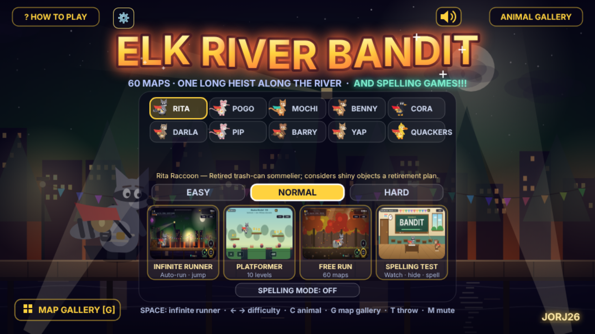
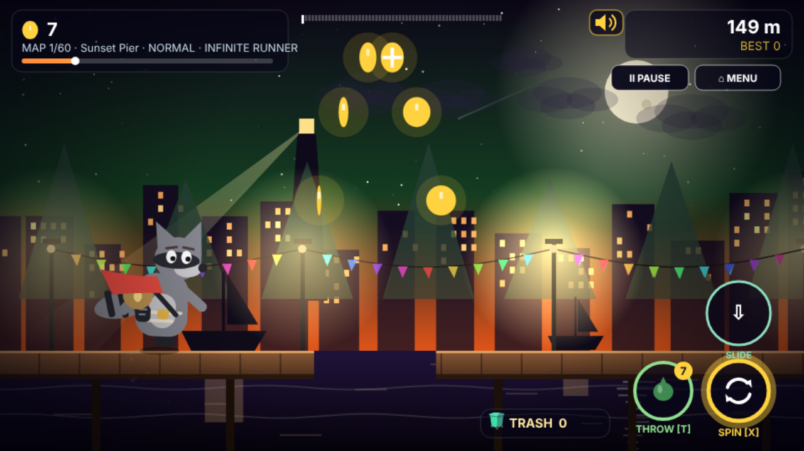

<p align="center"></p>

# Elk River Bandit 🦝

Run, jump and spell your way down the river. Three game styles, 60 maps, 10 bandit animals, a 21-song soundtrack and a spelling mode that turns any word list into a game.

**▶ Play in your browser: https://jorj2026.github.io/elk-river-bandit/**

| Platform | Get it |
|---|---|
| 🪟 Windows | [Latest release](../../releases/latest) → `…-Windows-Setup.exe` (or `-Portable.exe`) |
| 🍎 macOS | [Latest release](../../releases/latest) → `…-macOS.dmg` |
| 🐧 Linux | [Latest release](../../releases/latest) → `…-Linux.AppImage` or `.deb` |
| 🤖 Android | [Latest release](../../releases/latest) → `…-Android.apk` — or open the web game and tap **Install** |
| 📱 iPhone / iPad | Open the web game in Safari → Share → **Add to Home Screen** |

The same links are inside the game: **⚙️ Settings → Download**.




## What’s in this repo
```
index.html app.js style.css      the game (plain JS + canvas, no build step)
launch.js launch.css config.js   settings, downloads, stats, backup, offline
sw.js manifest.webmanifest       offline + install (PWA)
info/                            how-to-play, help, privacy, terms, credits, changelog
audio/ img/ icons/               assets (21 songs, art, icons)
native/electron/                 Windows · macOS · Linux wrapper
native/capacitor/                Android · iOS wrapper
scripts/                         build-web.js, check.js, serve.js
.github/workflows/               pages.yml (website) · release.yml (all downloads) · ci.yml
store/                           listing text, screenshots, feature graphic
```

## Run it locally
```bash
npm run serve        # http://localhost:8080
npm run check        # syntax + reference + song-list checks
npm run desktop      # Electron window (needs Node 18+, installs Electron)
```

## Publish & release
Read **[RELEASING.md](RELEASING.md)** — about ten minutes the first time: push to GitHub, switch on Pages, push a `v1.0.0` tag, and every download is built for you.

## The 50 launch additions
**Web app & offline** — 1 Web app manifest · 2 Icon set (any/maskable/Apple/favicon) · 3 Offline service worker (with audio range support) · 4 “New version ready” update toast · 5 Install-as-app button with iPhone steps · 6 Open Graph/Twitter share cards + share image · 7 `robots.txt` + generated `sitemap.xml` · 8 Custom 404 · 9 No-JavaScript fallback · 10 Offline / back-online banners

**Info pages** — 11 How to play · 12 Help & FAQ (install steps for every platform) · 13 Privacy · 14 Terms · 15 Credits & licenses · 16 What’s new

**⚙️ Settings** — 17 Gear button placed around the game’s own buttons, hidden while playing · 18 Tabbed settings dialog (keyboard-accessible, isolated from game input) · 19 Sound on/off synced with **M** · 20 Music volume · 21 Effects volume · 22 Song picker (shuffle or favourite) · 23 “Now playing” toast · 24 Vibration toggle · 25 Pause when you switch away (music too) · 26 Keep screen awake while playing · 27 Full-screen button · 28 In-game How-to-play dialog · 29 Rotate-your-phone hint · 30 Landscape lock for installed/native apps

**Progress & data** — 31 Stats tab · 32 Ten achievements · 33 Save backup · 34 Restore backup (validated, confirmed) · 35 Erase progress (confirmed) · 36 Warning when the browser blocks saved data

**Downloads** — 37 Detects your device · 38 Live latest-release lookup (cached, timeout, offline fallback) · 39 Windows installer + portable · 40 macOS `.dmg` (Apple silicon + Intel) · 41 Linux AppImage + `.deb` · 42 Android APK (+ AAB for Play) · 43 iPhone: Add-to-Home-Screen guide + sideloadable IPA · 44 Check for updates · 45 Share-link button

**Native apps & release** — 46 Electron desktop wrapper (sandboxed, no Node in the page, external links open in your browser, F11 full screen) · 47 Capacitor Android/iOS project (landscape, immersive full screen, haptics, splash) · 48 GitHub Actions release pipeline for all six targets · 49 Pages deploy + CI checks + build/serve scripts · 50 Store kit: listing text, feature graphic, screenshots

Also included: diagnostics + one-tap pre-filled bug report, LICENSE, CHANGELOG, SECURITY, CONTRIBUTING, issue/PR templates.

## Status — please read
Everything in the web game was tested in a real browser (settings, downloads tab with a mocked release, offline mode, backups, song shuffle). The **native installers are built by GitHub Actions the first time you push a tag** — they could not be compiled where this repo was prepared, so expect to fix a small thing or two on the first run (the workflow logs will say exactly what). The unsigned installers will show “unknown publisher” warnings; `info/support.html` explains the one-click workarounds.

© 2026 JORJ2026 — see [LICENSE](LICENSE).
